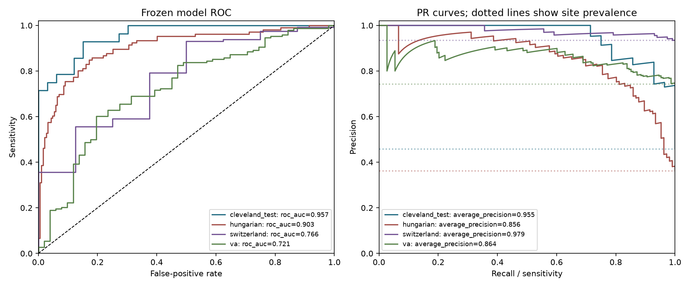
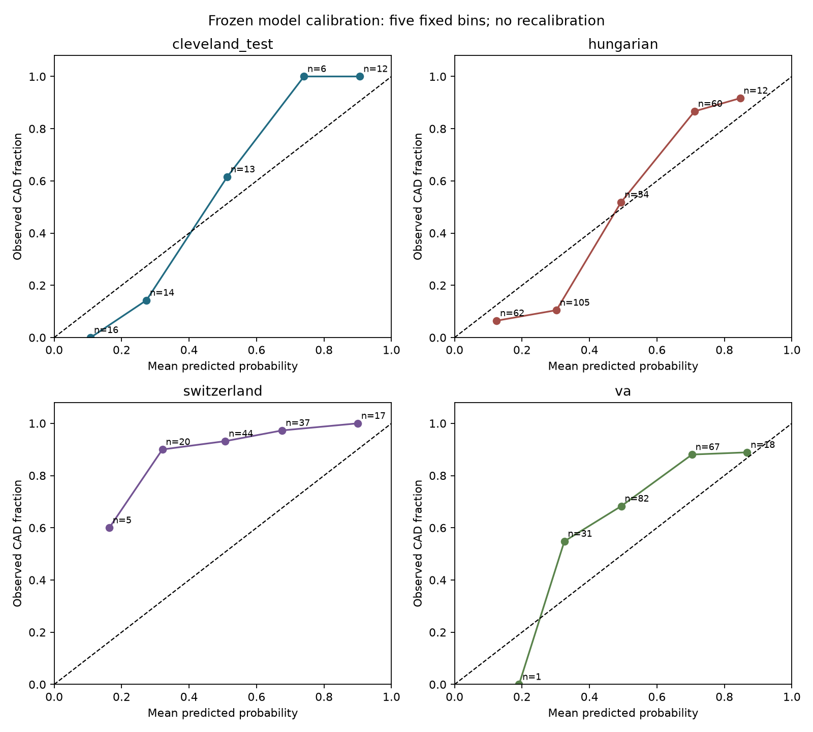
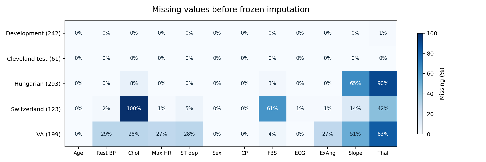
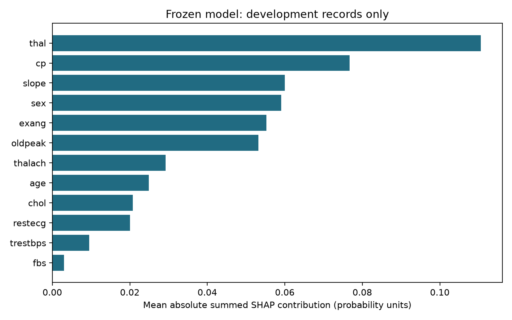
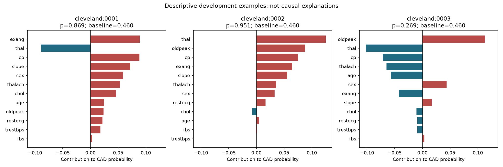

# Identifying existing coronary artery disease across historical UCI cohorts

**Frozen-model evaluation, explanations, and limits to cross-site transportability**

Lucas Medina | Statistics and Data Science, UCLA | October 22, 2026

Retrospective educational study. Prepared for healthcare analytics and health-tech audiences. No AHA affiliation, endorsement, or clinical deployment claim.

## Abstract

**Objective.** Evaluate whether a model developed in Cleveland identifies existing angiographic coronary artery disease (CAD) in a held-out internal cohort and three separate historical external cohorts. This study does not predict future cardiovascular events.

**Methods.** Cleveland records were partitioned into 242 development and 61 internal-test records before development. Twelve later-workup predictors excluded the angiography-related variable ca. Fold-fitted preprocessing, logistic baselines, and bounded tree-model comparisons preceded nested development selection of candidate, sigmoid calibration option, and sensitivity-driven cutoff. The accepted 200-tree Random Forest used no additional calibration and classified positive at probability >= 0.3528716233973672. Its model and cutoff were frozen before final evaluation. External duplicate, overlap, and physiologic-zero rules were documented before predictions. All sites were analyzed separately.

**Results.** Internal ROC-AUC was 0.957 (95% CI 0.907-0.990), sensitivity 26/28 (92.9%; 77.4-98.0%), and specificity 26/33 (78.8%; 62.2-89.3%). Hungarian, Swiss, and VA ROC-AUCs were 0.903, 0.766, and 0.721. Their sensitivities were 92.5%, 88.7%, and 93.9%, while specificities were 67.4%, 50.0%, and 23.5%. Switzerland contained only eight negative records. Missing predictors and disease prevalence differed substantially by site. The Swiss recorded sex=0 group had sensitivity 3/10. Nested development-policy sensitivity had been 98/111 (88.3%), below the exploratory 90% objective.

**Conclusion.** Strong internal discrimination did not translate into consistent external performance. High sensitivity coexisted with substantial false-positive burden at VA and sparse, concerning subgroup results. Probability calibration, later-workup predictor availability, historical selection, and provenance gaps limit interpretation. The evidence supports an educational transportability case study, not deployment or a safety guarantee.

**Evidence basis.** Final numerical results are the reviewed Day 8 outputs at repository commit 77d45a3f8b63d22df73f23742006975d9c69f6cb. Report preparation performs no new model fitting, predictions, recalibration, or threshold selection.

<!-- pagebreak -->

## 1. Clinical question, cohorts, and measurements

The target is recorded existing CAD: num=0 is negative and num in {1,2,3,4} is positive. UCI documents the processed heart-disease data and the angiographic outcome [1,2]. The intended setting is a later diagnostic workup in referred patients, because exercise and thallium-test results are required. Record-level timing is unavailable; pre-angiography availability cannot be verified for every measurement. This is not initial-presentation population screening.

**Table 1. Analysis populations and descriptive context.** External demographic counts are taken from the submitted subgroup outputs. External age medians were not supplied and are not inferred from age bands. Counts below describe the final analysis cohorts, not all source rows.

| Analysis cohort | n | CAD positive | Recorded sex=0 | Age median (IQR), y |
| --- | --- | --- | --- | --- |
| Development | 242 | 111/242 (45.9%) | 77/242 (31.8%) | 56 (48-61) |
| Cleveland test | 61 | 28/61 (45.9%) | 20/61 (32.8%) | Not summarized |
| Hungarian | 293 | 106/293 (36.2%) | 80/293 (27.3%) | Not summarized |
| Switzerland | 123 | 115/123 (93.5%) | 10/123 (8.1%) | Not summarized |
| VA Long Beach | 199 | 148/199 (74.4%) | 6/199 (3.0%) | Not summarized |

Sex=0 and sex=1 are the source's recorded female and male codes [1]; they are not a complete representation of gender. Development age and the continuous summaries below were recomputed from the original Cleveland source and frozen development IDs. IQR denotes the 25th to 75th percentiles. External source sizes were Hungarian 294, Swiss 123, and VA 200; one exact full-source duplicate each was removed in Hungary and VA. The 242 Cleveland development records were not internal-evaluation exclusions. Final evaluated total: 676 records across four separate cohorts.

**Table 2. Development-only continuous measurements: median (IQR).** These unadjusted summaries describe overlapping groups and are not causal effects or estimates of diagnostic accuracy.

| Development measurement | CAD absent (n=131) | CAD present (n=111) |
| --- | --- | --- |
| age (years) | 53.0 (45.5-60.0) | 57.0 (51.5-61.0) |
| trestbps (mm Hg) | 130.0 (120.0-140.0) | 130.0 (120.0-144.0) |
| chol (mg/dL) | 234.0 (207.5-265.5) | 248.0 (217.5-285.0) |
| thalach (beats/min) | 160.0 (144.5-172.0) | 142.0 (123.5-157.0) |
| oldpeak (source scale) | 0.4 (0.0-1.1) | 1.4 (0.6-2.5) |

**Predictors.** Numeric inputs were age, resting blood pressure, cholesterol, maximum achieved heart rate, and exercise ST depression. Categorical inputs were recorded sex, chest-pain type, fasting-glucose indicator, resting ECG, exercise-induced angina, exercise ST slope, and thal test result. The variable ca was excluded because it is angiography related; num was never an input. The primary analysis includes no smoking, BMI, HDL, longitudinal outcomes, or invented measurements. Optional 13-feature and presentation-only ablations were not performed.

<!-- pagebreak -->

## 2. Development, model selection, and statistical analysis

**Leakage controls.** The first seeded five-fold stratified group split fixed the internal test. Identical predictor records stayed together; the frozen 12-predictor checks found no internal development/test matches. The 242 development records used five fixed folds. Within each training partition, numeric median imputation and standardization preceded classification; categorical mode imputation and full one-hot encoding ignored unknown categories. No automatic oversampling was used. Extreme observations were retained without evidence of measurement error.

**Development comparisons.** Day 4 used dummy and L2 logistic models; Day 5 used three inner folds to select among four settings per tree family within each outer training set. The forest varied depth {3, None} and leaf size {3, 8}. XGBoost varied depth {1, 2} and tree count {100, 250}. These comparisons used cutoff 0.5, and did not evaluate the final frozen forest on test records.

**Table 3. Pooled development out-of-fold results at cutoff 0.5.** Model-family shortlist selection reused development evidence; small differences do not establish statistical superiority.

| Model | ROC-AUC | AP | Brier | Sensitivity | Specificity |
| --- | --- | --- | --- | --- | --- |
| Dummy prior | 0.4934 | 0.4551 | 0.2483 | 0.0% | 100.0% |
| Logistic, unweighted | 0.8484 | 0.8251 | 0.1571 | 73.0% | 80.2% |
| Logistic, balanced | 0.8486 | 0.8245 | 0.1579 | 77.5% | 80.2% |
| Nested Random Forest | 0.8660 | 0.8552 | 0.1546 | 74.8% | 83.2% |
| Nested XGBoost | 0.8485 | 0.8345 | 0.1572 | 71.2% | 82.4% |

**Day 6 selection policy.** Ten candidates comprised unweighted logistic and four forest configurations, each with/without sigmoid calibration. Inner cross-fitting within each outer training set selected a cutoff with sensitivity >=0.90 and maximum specificity, breaking candidate ties by lower Brier then ID. Within a candidate, the highest cutoff at maximum feasible specificity won. Sigmoid calibration used a further three-fold split when applicable. The 90% objective was exploratory, not an AHA recommendation.

Outer assessment of this policy yielded ROC-AUC 0.8418, AP 0.8149, Brier 0.1598, sensitivity 98/111 (88.3%), and specificity 82/131 (62.6%). Candidate winners varied across folds. Full-development cross-fitted selection then chose c06; its selection sensitivity 100/111 (90.1%) and specificity 88/131 (67.2%) are not independent performance estimates. The final model was fitted on all 242 development records: 200 trees, unlimited depth, leaf size 3, sqrt feature sampling, no class weights, seed 42, n_jobs=1. No extra calibrator was selected.

**Final uncertainty.** At the unchanged cutoff, sensitivity, specificity, PPV, and NPV use 95% Wilson intervals. ROC-AUC, AP, and Brier use 2,000 ordinary within-site row bootstraps, seeds 8100-8103. Single-class resamples are omitted for AUC/AP; Switzerland retains 1,999, all other site/metric pairs 2,000. Brier uses all draws. Intervals are conditional on this fitted model and do not incorporate training/selection uncertainty. AP is not trapezoidal PR area. Brier measures overall probability error, not calibration alone [3].

<!-- pagebreak -->

## 3. Final frozen-model performance

**Table 4. Internal and separate external estimates with descriptive 95% intervals.** The model and cutoff are identical across sites. Differences are descriptive; no paired model comparison or formal between-site test was conducted.

| Cohort | ROC-AUC (95% CI) | Sensitivity (95% CI) | Specificity (95% CI) |
| --- | --- | --- | --- |
| Cleveland test | 0.957 (0.907-0.990) | 92.9% (77.4%-98.0%) | 78.8% (62.2%-89.3%) |
| Hungarian | 0.903 (0.864-0.939) | 92.5% (85.8%-96.1%) | 67.4% (60.4%-73.7%) |
| Switzerland | 0.766 (0.591-0.925) | 88.7% (81.6%-93.3%) | 50.0% (21.5%-78.5%) |
| VA Long Beach | 0.721 (0.639-0.799) | 93.9% (88.8%-96.8%) | 23.5% (14.0%-36.8%) |

**Table 5. Operating-point errors and additional performance measures.** TP=true positive; FN=false negative; TN=true negative; FP=false positive; PPV=precision; NPV=negative predictive value. AP and Brier intervals are available in the linked machine-readable site table.

| Cohort | TP/FN/TN/FP | AP | Brier | PPV | NPV |
| --- | --- | --- | --- | --- | --- |
| Cleveland test | 26/2/26/7 | 0.955 | 0.099 | 78.8% | 92.9% |
| Hungarian | 98/8/126/61 | 0.856 | 0.133 | 61.6% | 94.0% |
| Switzerland | 102/13/4/4 | 0.979 | 0.211 | 96.2% | 23.5% |
| VA Long Beach | 139/9/12/39 | 0.864 | 0.200 | 78.1% | 57.1% |

**Figure 1.** Dotted PR lines indicate each cohort's prevalence: Cleveland 45.9%, Hungary 36.2%, Switzerland 93.5%, VA 74.4%. High Swiss AP (0.979) and PPV (96.2%) coexist with NPV of only 23.5% and weaker ROC discrimination. AP must be interpreted with site prevalence rather than ranked alone.

The internal point estimate exceeds the 90% sensitivity objective, but its lower limit is 77.4%. Switzerland misses 13/115 positives. VA misses 9/148 positives but classifies 39/51 negatives as positive, a 76.5% false-positive rate among negatives. FP/n at VA is 19.6%, a different denominator. The results do not certify a population sensitivity target or consistent cross-site performance.

<!-- pagebreak -->

## 4. Probability calibration

**Figure 2.** Fixed-width probability bins show mean predicted probability against observed CAD fraction; labels give bin counts. The diagonal represents agreement. These are descriptive curves without uncertainty bands. No external recalibrator was fitted. Small upper Cleveland bins contain 6 and 12 records. Swiss observed fractions exceed predictions throughout; VA shows this in most occupied bins. The pattern raises transportability concerns without establishing their cause [3].

<!-- pagebreak -->

## 5. Data availability and external cohort rules

**Figure 3.** Cell labels show missing percentages rounded to whole numbers after the predefined zero correction. Development values are from the reviewed Cleveland development summary; final-cohort values come from the submitted Day 8 cleaning audit. No site-specific imputer was fitted. Near-complete development data contrast with extensive external missingness, including entirely unavailable Swiss cholesterol. BP=resting blood pressure; CP=chest-pain type; FBS=fasting-glucose indicator; ExAng=exercise angina. Missingness patterns are descriptive and do not prove why model performance changes.

**Prespecified before final predictions.** The Day 8 addendum kept the first exact full-source duplicate and removed external rows matching any Cleveland row on all 12 raw primary predictors. The submitted audit reports zero such overlaps. External cholesterol/resting-pressure zeros became missing; legitimate zeros and finite negative oldpeak values were retained. Every site used the frozen Cleveland preprocessing pipeline. These operational rules were clarified on Day 8, not all fixed on Day 1.

**Missingness after zero correction, before frozen imputation.** Swiss cholesterol was missing for 123/123 records. VA cholesterol was missing for 56/199 (including 49 zero corrections); resting pressure for 57/199 (including one zero correction); thal for 165/199. Hungary had thal missing for 265/293 and slope for 189/293. Development had only two missing thal measurements. These differences could contribute to changed performance, but no causal decomposition was performed. Missingness counts are documented in the submitted cleaning audit; external raw bytes were not independently reloaded during the Day 8 review.

<!-- pagebreak -->

## 6. What the frozen model uses: global and local explanations

SHAP describes contributions to individual predictions [4]. Day 7 used tree-path attribution for the frozen forest on 242 development training records, with training path counts as background. For this scikit-learn forest, the reviewed raw-output explanation reconstructs class-1 probabilities; the reported maximum reconstruction error was 7.77e-16. One-hot contributions were summed to original inputs, preserving additivity without recomputing grouped-coalition Shapley values.

**Figure 4.** Leading mean absolute contributions were thal 0.1106, cp 0.0768, slope 0.0600, sex 0.0590, and exang 0.0553 probability units. A magnitude of 0.1106 is about 11.1 probability percentage points, not a coefficient, causal effect, or 11.1% share of all importance. Correlated inputs and background assumptions affect attribution.

**Figure 5.** Examples were the first three development IDs in lexical order, not chosen for dramatic errors. For cleveland:0001, exang=1 contributes about +8.91 points and thal=3 about -8.90 points relative to the explanation baseline. All contributions move a baseline near 0.4602 to a prediction near 0.8691. These are training-record explanations, not individual diagnostic advice or validation evidence. Full local SHAP matrices and the accepted binary were not uploaded; manifest and matching reference checks support the computation.

<!-- pagebreak -->

## 7. Subgroup findings and implications

Final subgroup summaries use the unchanged forest and cutoff, recorded sex codes, and age bands <50, 50-59, and >=60. They differ from Day 7's out-of-fold selection-policy subgroups. All 24 final rows reconcile algebraically with their cohort totals; the six Cleveland rows also reproduce from source demographics. External subgroup membership was not independently reloaded during review. Full confusion counts and Wilson limits are retained in the supplementary subgroup CSV.

**Table 6. Selected final subgroup results.** Counts in the third column are CAD-positive / CAD-negative. Rows with either outcome denominator <20 are sparse. All Swiss specificity estimates are based on eight or fewer negatives.

| Cohort | Group | Positive/negative | Sensitivity (95% CI) | Specificity |
| --- | --- | --- | --- | --- |
| Cleveland test | sex=0 | 7/13 | 85.7% (48.7%-97.4%) | 11/13 (84.6%) |
| Cleveland test | sex=1 | 21/20 | 95.2% (77.3%-99.2%) | 15/20 (75.0%) |
| Hungarian | sex=0 | 12/68 | 75.0% (46.8%-91.1%) | 60/68 (88.2%) |
| Hungarian | sex=1 | 94/119 | 94.7% (88.1%-97.7%) | 66/119 (55.5%) |
| Switzerland | sex=0 | 10/0 | 30.0% (10.8%-60.3%) | Undefined (0 negatives) |
| Switzerland | sex=1 | 105/8 | 94.3% (88.1%-97.4%) | 4/8 (50.0%) |
| VA Long Beach | sex=0 | 3/3 | 66.7% (20.8%-93.9%) | 2/3 (66.7%) |
| VA Long Beach | sex=1 | 145/48 | 94.5% (89.5%-97.2%) | 10/48 (20.8%) |
| VA Long Beach | age <50 | 10/9 | 70.0% (39.7%-89.2%) | 4/9 (44.4%) |
| VA Long Beach | age 50-59 | 56/19 | 89.3% (78.5%-95.0%) | 6/19 (31.6%) |
| VA Long Beach | age 60+ | 82/23 | 100.0% (95.5%-100.0%) | 2/23 (8.7%) |

The Swiss sex=0 group misses 7/10 positives, compared with 6/105 for sex=1. Its specificity is undefined because no negative record occurs in that group. Hungary's sex=0 sensitivity is 9/12 compared with 89/94 for sex=1. These findings deserve explicit attention; small samples do not make the missed cases unimportant. They also do not establish a population disparity, its cause, or a fairness certification. The VA age >=60 group detects 82/82 positives but identifies only 2/23 negatives correctly.

**Decision implication.** The model's internal discrimination is a useful portfolio result, but the external error patterns are the central finding. A high overall sensitivity can conceal large false-positive burdens and poor performance in sparse groups. No clinical benefit, downstream referral reduction, decision-curve net benefit, economic gain, or treatment effect was measured. No deployment or triage recommendation follows from this study. Any future adaptation needs newly separated development and validation data; the exposed cohorts cannot become a fresh untouched test set.

<!-- pagebreak -->

## 8. Limitations, provenance, and reporting boundaries

**Population and timing.** Historical referred patients differ from contemporary screening and primary-care populations. Outcome prevalence ranges from 36.2% to 93.5% externally. Predictor availability, selection into workup, measurement practice, and missingness could all affect transportability; the study does not separate their effects. Individual collection dates, feature timestamps, and complete inclusion pathways are unavailable. Excluding ca reduces obvious target proximity without proving that every remaining feature precedes the reference diagnosis.

**Sample size and selection.** The internal test has 28 positives and 33 negatives; Switzerland has eight negatives. Wide intervals and sparse subgroups limit precision. Development model-family shortlisting reused folds and performance evidence. The nested Day 6 assessment estimates its stated candidate-selection procedure conditional on that shortlist, not all research choices. No sample-size or power calculation was performed; available source sizes determined the study. Conditional row bootstraps do not capture fitting uncertainty or unknown repeated-patient dependence.

**Cohort identity.** Exact full-row duplicate removal and predictor matching are record heuristics, not verified patient identifiers. Cross-external identity cannot be established. No external pooling is used. The external cleaning/exclusion rules were specified in a pre-evaluation Day 8 addendum; the timing of that clarification is disclosed.

**Probability and explanation.** Five-bin curves are coarse and have no interval bands. Brier reflects discrimination and outcome uncertainty as well as calibration [3]. No calibration slope/intercept, decision-curve analysis, adjusted subgroup comparison, or causal attribution was estimated. SHAP explains the fitted model under its background assumptions; it does not validate a predictor's biological importance or establish a treatment target.

**Artifact provenance.** The accepted Windows joblib binary remains local. Its identity is supported by Lucas's earlier successful local checksum comparison and the submitted Day 8 manifest, not a second independent load during review. Day 8 numerical review reproduced all four sites' point estimates and intervals from 676 saved probabilities, verified internal test IDs/labels, and matched six submitted CSVs plus ROC/PR and calibration PNG hashes. External raw bytes and external demographic membership were not reloaded. Day 8 terminal output, exit code, and full environment export were not supplied; recorded package versions remain available.

**Unresolved image-byte discrepancy.** The uploaded site_comparison.png differs from the manifest hash despite visually matching the verified estimates and intervals. The original attachment and historical manifest are preserved. This report uses the checksum-matching ROC/PR and calibration figures and does not rely on that image for quantitative evidence. Detailed hashes and limits appear in reports/day08/review_checks.json. Reconstructed curve/bin CSVs are identified as derived from submitted probabilities, not original local bytes. Git may normalize CSV line endings.

**Governance.** This is secondary analysis of supplied public, de-identified historical data. No new participant recruitment or intervention occurred, and no institutional ethics determination, prospective study, clinical integration, or AHA endorsement is claimed. Reporting covers the relevant study-design, methods, results, and access topics emphasized by TRIPOD+AI [5], without claiming a completed formal checklist or independent risk-of-bias assessment. No project-specific funding or conflicts disclosure was supplied; no formal declaration is inferred.

<!-- pagebreak -->

## 9. Reproducibility, evidence map, and references

The Markdown source and PDF summarize the reviewed analysis without running the model. The accepted artifact SHA-256 is 948f8939076cdc1e001a74d7bb414b28c88e21b7de32b0a2172fdc4a805ce1ae. The decision rule is probability >= 0.3528716233973672. Freeze metadata remains historical; its original holdout_analyzed=false reflects Day 6, while the final Day 8 manifest correctly records evaluation access.

The local manifest records Python 3.12.10, scikit-learn 1.9.1, NumPy 2.5.4, pandas 2.3.3, and joblib 1.6.0; Day 7 records SHAP 0.50.0. Broad requirements ranges alone do not guarantee binary-compatible reproduction. The accepted local bundle is not publicly committed; the reference bundle must not be substituted as the evaluated model. Day 10 will address environment capture, clean-environment verification, model-card/access documentation, executive summary, and release packaging. None is represented here as already complete.

**Table 7. Repository evidence map.** Paths are relative to the project root.

| Evidence | Location |
| --- | --- |
| Original methods and predictor definitions | docs/protocol.md; docs/data_dictionary.csv |
| Development EDA and model comparisons | reports/day02/interpretation.md; reports/day04; reports/day05 |
| Accepted model and selection-policy review | reports/day06/accepted_freeze.json; interpretation.md |
| Explanation and development subgroup review | reports/day07/interpretation.md; global_shap.csv; local_explanations.csv |
| Final estimates, predictions, subgroups | reports/day08/site_metrics.csv; predictions.csv; subgroup_metrics.csv |
| Cohorts, exclusions, cleaning | reports/day08/cohort_audit.csv; exclusions.csv; missingness_and_cleaning.csv |
| Run and review evidence | reports/day08/run_manifest.json; review_checks.json; interpretation.md |
| Report source, checks, and source hashes | reports/day09/report.md; report_checks.json |

**Regenerate this PDF only.** Install ReportLab in a separate reporting environment and run python scripts/build_day09_report.py from the project root. This renders the reviewed Markdown and embedded figures; it does not open the model or raw data. Do not upgrade the frozen modeling environment solely to build the report. This document remains an educational research report, not a clinical product specification.

## References and attribution

[1] Janosi A, Steinbrunn W, Pfisterer M, Detrano R. Heart Disease [Dataset]. UCI Machine Learning Repository; 1989. DOI: [10.24432/C52P4X](https://doi.org/10.24432/C52P4X). [Dataset documentation](https://archive.ics.uci.edu/dataset/45/heart+disease). Accessed October 22, 2026. UCI lists CC BY 4.0; data and code licensing are separate. Acknowledge Andras Janosi, William Steinbrunn, Matthias Pfisterer, and Robert Detrano. The raw source files remain excluded from this repository.

[2] Detrano R, Janosi A, Steinbrunn W, et al. International application of a new probability algorithm for the diagnosis of coronary artery disease. American Journal of Cardiology. 1989;64:304-310. DOI: [10.1016/0002-9149(89)90524-9](https://doi.org/10.1016/0002-9149(89)90524-9). Cited for source provenance, not as validation of the present model.

[3] scikit-learn developers. Probability calibration. [Official documentation](https://scikit-learn.org/stable/modules/calibration.html). Accessed October 22, 2026.

[4] Lundberg SM, Lee SI. A unified approach to interpreting model predictions. Advances in Neural Information Processing Systems 30; 2017. [arXiv:1705.07874](https://arxiv.org/abs/1705.07874). Cited for the additive explanation framework; the project's implementation and limitations are recorded separately.

[5] Collins GS, Moons KGM, Dhiman P, et al. TRIPOD+AI statement: updated guidance for reporting clinical prediction models that use regression or machine learning methods. BMJ. 2024;385:e078378. DOI: [10.1136/bmj-2023-078378](https://doi.org/10.1136/bmj-2023-078378).

Project: [UCI_Heart_Disease_Project](https://github.com/MucasLucas/UCI_Heart_Disease_Project). Final results are original project outputs, not values taken from these methodological references.
